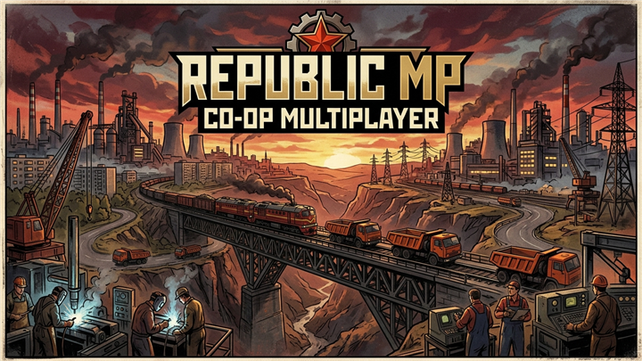

<div align="center">

# ☭ RepublicMP — Кооперативный мультиплеер для Workers & Resources: Soviet Republic



**Полноценный кооперативный мод с детерминированной синхронизацией Lockstep, подключением через Steam P2P в 1 клик, нативным внутриигровым меню, режимом «Два государства на одной карте» и автоматической двусторонней синхронизацией модов Мастерской Steam.**

</div>

---

## 🔥 Ключевые возможности

### 1. Полная интеграция в нативный интерфейс игры
- **Никаких чужеродных плавающих окон:** раздел **«КООПЕРАТИВ»** встроен прямо в главное меню игры и в левую системную панель **`☭ -> Кооператив`** со стилизованными советскими иконками.
- **Поддержка Русского и Английского языков** с автоматическим определением языка игры.

### 2. Два режима совместной игры
- **Одно государство (Общая республика):** классический кооператив с общим бюджетом (рубли и доллары) и совместным строительством всей республики.
- **Два государства на одной карте (Западная ССР и Восточная ССР):**
  - Карта делится на **Западную ССР (Хост, `X < 0`)** и **Восточную ССР (Гость, `X > 0`)** с настраиваемой **общей пограничной зоной** (`150 / 250 / 500 / 1000 м`) для стыковки дорог, ЖД-путей, ЛЭП и трубопроводов.
  - **Раздельная экономика и казна:** у каждого государства свой баланс в рублях и долларах (на выбор: **100% стартового капитала каждому** или **деление 50/50**).
  - **Персональная собственность и торговля:** здания, строительные конторы, автобазы, таможни и техника автоматически привязываются к государству-владельцу; все доходы и расходы начисляются в бюджет соответствующей республики.
  - **Межгосударственные переводы:** мгновенная отправка финансовой помощи (`50 000 РУБ` или `50 000 $`) партнёру прямо из боковой панели `☭`.

### 3. 100% автоматическая синхронизация модов Steam Workshop
- **Никаких списков с галочками:** все установленные моды из Мастерской Steam и `workshop_wip` включены автоматически, как в базовой игре.
- **Обоюдная авто-докачка (Хост ↔ Клиент + Сейв):**
  - Если у Хоста или в сохранении есть моды, которых нет у Клиента — **их автоматически скачивает Клиент**.
  - Если у Клиента стоят свои моды из Мастерской, которых нет у Хоста — **их автоматически скачивает Хост**.
  - Локальные `workshop_wip` моды автоматически передаются напрямую по сети во временную песочницу сессии и очищаются после выхода.
  - Списки зданий и техники автоматически сортируются в идентичном порядке для полной совместимости в Lockstep.

### 4. Изолированный банк кооп-сохранений (`save_coop`)
- **Одиночные и кооперативные сохранения полностью разделены:** выход из кооп-игры автоматически сохраняет прогресс в отдельный банк `save_coop` (`Продолжить кооп`), никогда не перезаписывая одиночный `saved_last`.
- **Импорт одиночного сейва в кооп** в один клик без изменения оригинала.
- **Быстрое сохранение кооп-игры** прямо из левой боковой панели `☭ -> Кооператив` с сохранением бюджетов обоих государств и привязки зданий/техники (`republicmp_coop.ini`).

### 5. Подключение через Steam P2P без VPN и проброса портов
- **Список друзей Steam онлайн** прямо в меню **«КООПЕРАТИВ -> Подключиться»** — подключение к другу в 1 клик через Steam Networking (`SteamRelay`).
- Также поддерживается прямое подключение по IP-адресу или `steam:<SteamID64>` из буфера обмена.

### 6. Командные инструменты и настройка границ карты
- **Стандартная карта 20×20 км с границами** по умолчанию или **расширение застройки на всю карту без пограничного отступа** одной кнопкой в настройках коопа.
- **3D-курсор напарника в реальном времени**, быстрый прыжок камеры к партнёру (**`F6`**), 3D-маяки на местности (**`Alt + ЛКМ`**) и переключение видимости 3D-границы (**`F7`**).

---

## 🚀 Как установить и запустить

1. Подпишитесь на мод в **Steam Workshop** или скачайте архив **`RepublicMP_Friend_Pack.zip`** из раздела [**Releases**](../../releases).
2. Распакуйте архив (или откройте папку мода в `steamapps\workshop\content\784150\3823543010\`) и запустите **`START-COOP.bat`** (либо создайте ярлык на Рабочем столе через **`CREATE-DESKTOP-SHORTCUT.bat`**).
3. При наличии `dinput8.dll` в папке игры (`SovietRepublic\`) мод также подхватывается **автоматически при обычном запуске игры через кнопку «Играть» в Steam**.
4. В главном меню игры нажмите **«КООПЕРАТИВ»**:
   - **Хост:** `КООПЕРАТИВ` -> `Создать сервер` -> выберите `Продолжить кооп`, `Кооп-сохранения`, `Импорт одиночного` или `Новая своя игра`.
   - **Игрок 2:** `КООПЕРАТИВ` -> `Подключиться` -> кликните по имени друга в списке **Steam** (или вставьте его SteamID / IP).

---

## ⌨️ Горячие клавиши в игре

| Клавиша | Действие |
| :--- | :--- |
| **`☭ -> Кооператив`** | Открыть панель управления кооперативом, сохранить кооп-игру или перевести деньги |
| **`F6`** | Переместить камеру к 3D-курсору или сигнальному маяку партнёра |
| **`F7`** | Показать / скрыть 3D-границу между Западной и Восточной ССР |
| **`Alt + ЛКМ`** | Поставить 3D-маяк (сигнал на карте) для партнёра |

---

## 🛠️ Сборка из исходного кода

Требуется Visual Studio 2022 (или Build Tools с компонентом `VC.Tools.x86.x64`):

```bat
TesmioLoader\build.bat
```

Выходные файлы собираются в `TesmioLoader\build\` (`tesmioloader.dll`, `dinput8.dll`, `tesmiolauncher.exe` и `plugins\RepublicMP.dll`).
